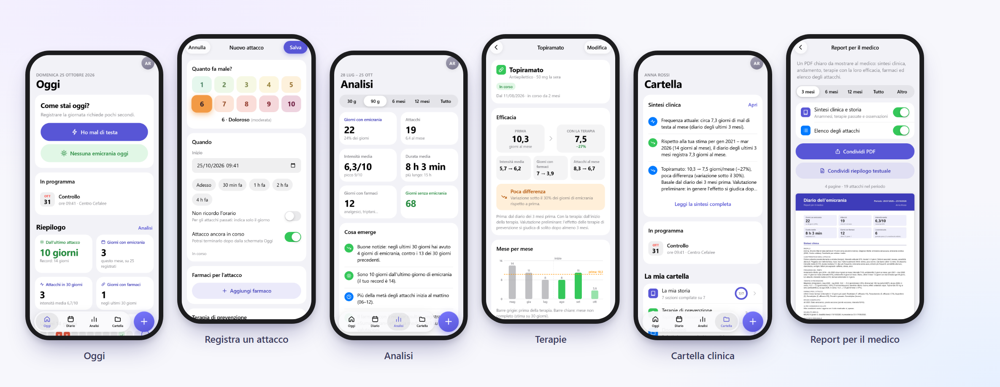
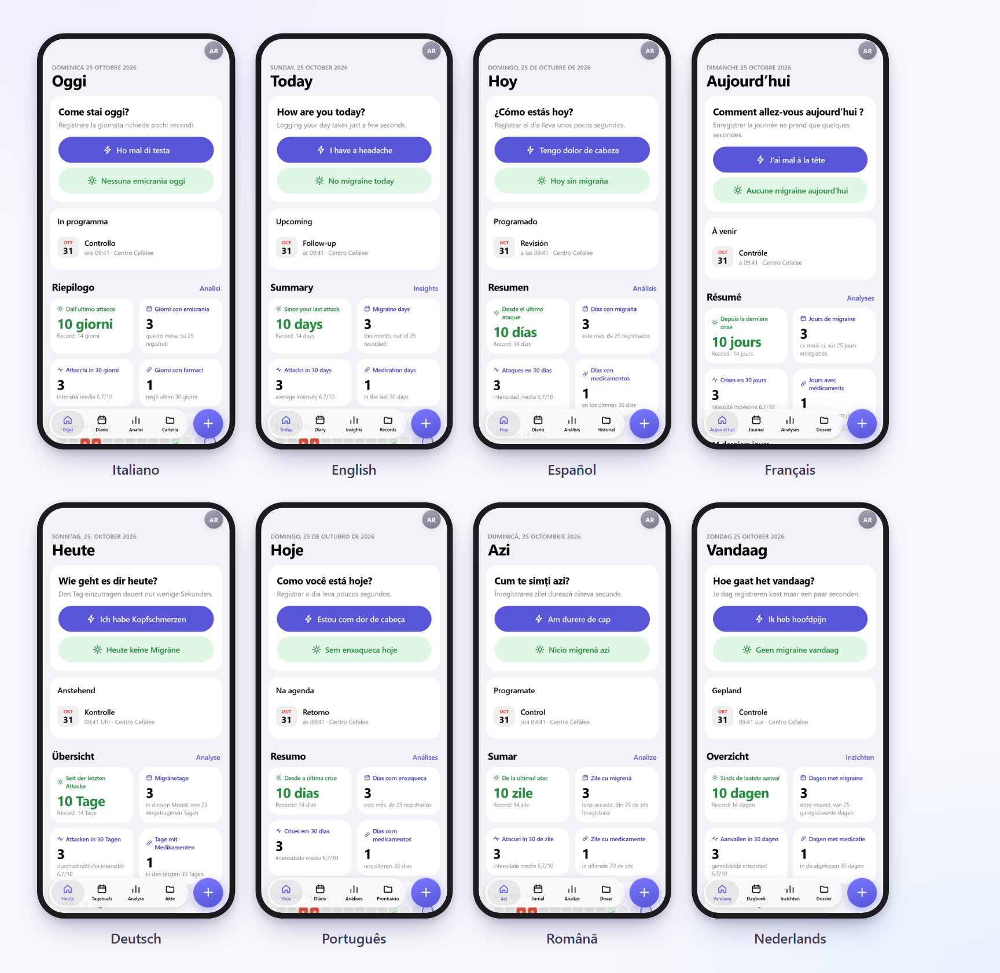

<div align="center">


<br>

**The migraine diary that lives in your phone.**<br>
Remember every attack, understand what works, and tell your doctor the whole story with real data.

<br>

[](https://davalz.github.io/app_emicrania/)


[🇮🇹 Italiano](README.md) &nbsp;·&nbsp; [🇬🇧 English](README.en.md)

</div>

---

## 💜 Why I built it

My girlfriend has had migraines since she was a child.

Anyone who lives with them knows it is not "just a headache". Attacks come when they want to, and on the day of the appointment you have to answer questions that sound simple — *how many times? how bad? how long did it last? what did you take? did it work?* — from memory, months later. The neurologist needs numbers; after years of pain, memory tends to keep only the exhaustion.

And then there is the rest of the story: the treatments tried and abandoned, the tests, the reports, the discharge letters scattered across folders, e-mails and photos in the camera roll.

I made **Diario Emicrania** to give her a simple tool that takes a few seconds to fill in even with a pounding head, and that turns what she records into a **clear report to bring to the appointment**. Then I kept adding what was really needed: preventive treatments, a medical folder, and a way to tell the story of the past years.

It was made for her, but it can help anyone living with this. And it collects nothing: **everything stays on the phone**.

<div align="center">

</div>

## ✨ What it does

### 📝 Logging, without effort
- An attack in a few taps: just the **intensity** from 1 to 10. If you feel like it: type, side, location, symptoms, triggers, impact on your day, notes.
- **Ongoing attack** with a timer, to end with one tap; quick "I took a medication" button.
- **"I don't remember the time"** for past attacks: the day and a rough duration are enough.
- Medications with time, dose and **effectiveness**; a ready-made list you can customise.
- Daily details (sleep, stress, mood, water, coffee, cycle…) to find out what is related to the attacks.

### 💊 Preventive treatments
- Treatments prescribed by the neurologist, **including past ones**: anti-CGRP monoclonal antibodies, botulinum toxin, antidepressants, beta-blockers, anticonvulsants, gepants, supplements…
- Dates of each administration, **next dose** shown on the Today screen.
- **Effectiveness**: migraine days, intensity and medication days **before and during** the treatment, with percentage reduction, a month-by-month chart and the trend inside each cycle.
- A short section in each attack to say whether the treatment is helping.

### 🗂️ My story and the medical folder
- **Tell the story of the past years** without filling in the diary backwards: onset, diagnosis, family history, frequency over the years, important episodes, treatments already tried… The app takes it into account, like a doctor would.
- An automatic **clinical summary** that combines your story and the diary, with careful observations to discuss with your doctor.
- **Hospital documents** (PDF and photos, even multi-page) in a tidy folder, with a built-in viewer.
- Treating centre, appointments with the questions to ask, **MIDAS** questionnaire.

### 📥 Got an old diary? Import it
If you kept your attacks in the **Notes** app (or in a PDF, a Word document, a text file) before using this one, there is nothing to retype: go to **Settings › Data and backup › Import from notes or a PDF**, choose the file — or paste the text — and the calendar fills itself in.
- It understands **dates written in many ways** (`26.06`, `26/06/2024`, `3 September`, `19/20.07`, `3-4.09`), year and month headings ("2025", "Early October") and works out the year when it is missing.
- It recognises **intensity** ("7/10", "very strong"), **side and area** of the pain, **aura**, symptoms, triggers, **period**, ER visits and **medications** with dose, quantity and effect ("2 oki", "imigran 50 did not work"), even with a few typos.
- It reads notes in **all 8 languages**, even mixed, from PDF, plain text, RTF, HTML, Word, OpenDocument and CSV.
- **Never blind**: before saving there is a preview where every line can be checked, corrected or excluded, and anything unclear is flagged. An import can be **undone** right away or **deleted** later, and reading the same note again does not create duplicates.
- It all happens **on the phone**: the file is never sent anywhere.
- One honest limit: it cannot read photos or scans (there is no optical character recognition). You need a PDF with selectable text, or the pasted text.

### 📊 Understanding and sharing
- A calendar coloured by intensity, analysis by period, the most frequent weekdays and times, a multi-year trend with treatments.
- Medication-overuse warning, automatic suggestions, weather and air pressure (optional).
- **PDF report for your doctor**, full backup with documents, CSV export, PIN lock, dark theme and a **relief mode** for when light hurts.

### 🌍 In 8 languages
Italiano, English, Español, Français, Deutsch, Português (Brasil), Română, Nederlands. Change it in **Settings › Language**; your data is not touched. The first time, the app starts in your phone's language.

<div align="center">

</div>

## 📲 Install on iPhone

1. Open **<https://davalz.github.io/app_emicrania/>** in **Safari**.
2. Tap **Share** (the square with the arrow) › **Add to Home Screen**.
3. Always open the diary **from the icon**: from then on it runs full screen, even without a connection.

> The icon and Safari have separate storage: start logging only after you have installed the app.

It also works on Android and on a computer, in any recent browser.

## 🔒 Privacy

- Your data (documents included) stays **only in the phone's storage**: no account, no server, no analytics.
- The only outgoing connection is the weather, **only if you turn it on** (Open-Meteo, with an approximate location).
- If you delete the icon or Safari's data, the data is lost: the app reminds you to make a **backup** (*Settings › Data and backup*) and save it in Files or iCloud Drive.

> ⚠️ **This is not a medical device.** It records and summarises what you enter, but it does not diagnose and does not replace your doctor's advice.

## 🚀 Publish and update on GitHub

<details>
<summary><b>First publication (GitHub Pages)</b></summary>

**With GitHub Desktop (recommended: no limit on the number of files)**
1. Unzip into a folder, for example `Documents\app_emicrania`.
2. In GitHub Desktop: *File › Add local repository…* and pick that folder; when it says it is not a repository, click **create a repository** › *Create repository*.
3. **Publish repository**: untick *Keep this code private* (with the free plan GitHub Pages only works with public repositories; there is no personal data in the app) and confirm.
4. On github.com open the repository › **Settings › Pages › Build and deployment**: *Deploy from a branch*, branch `main`, folder `/ (root)` › *Save*.
5. After a minute or two the app is live at `https://<user>.github.io/<repository>/`.

**From the browser (nothing to install)**
Create a **public** repository, then **Add file › Upload files** and drag **the contents** of the folder (not the folder itself). GitHub accepts at most 100 files at a time and the app has just under that (about 95): one upload is usually enough; if the page complains about too many files, upload in two batches (first the files in the root and `js`, then `css`, `icons`, `vendor`, `docs`, `tests`, `tools`). Then step 4 above.

</details>

<details>
<summary><b>Update the app without recreating the repository</b></summary>

Never delete or recreate the repository: just **replace the files** with those of the new version. GitHub keeps the history and sees only what changed. Three ways, from the easiest.

**1 · GitHub Desktop (recommended)**
1. Unzip the new version.
2. Copy **everything** into the repository folder (the one linked to GitHub Desktop) and choose *Replace the files in the destination*.
3. GitHub Desktop lists only the changed files: write a title (e.g. "Version 2.2") › **Commit to main** › **Push origin**.

To also delete files that no longer exist in the new version, empty the repository folder first (except the hidden `.git` folder) and then copy the new version.

**2 · From PowerShell** (with Git installed)
```powershell
cd C:\path\to\repository
# copy the contents of the new version here, then:
git add -A
git commit -m "Version 2.2"
git push
```
To also remove files that no longer exist in the new version, empty the folder first (except `.git`) and then copy the new version.

**3 · From the browser**
*Add file › Upload files*, drag the contents of the new version and confirm: files with the same name are replaced. Deleted files must be removed by hand (⋯ › Delete file).

**After uploading**, GitHub Pages republishes by itself in 1–2 minutes. On the iPhone, opening the app shows "A new version of the app is available.": tap **Update** (or close and reopen the app). Your data is not touched.

> `sw.js` is the file that tells phones about an update: it is already refreshed in every delivered version. If you edit files by hand, regenerate it with `python tools/build_sw.py` before publishing.

> ⚠️ **A new address is a new app.** Data is tied to the address the app was installed from. If you publish under another account or repository name (so a different address), the icon already on the phone does not update: first make a **full backup** (*Settings › Data and backup*), then install the app from the new address and **restore the backup**.

</details>

## 🛠️ For developers

<details>
<summary><b>Structure, tests and translations</b></summary>

Plain static files: nothing to install and no build step. PDF.js (Mozilla, Apache-2.0) is bundled in `vendor/pdfjs`.

```
index.html, manifest.webmanifest, sw.js    app shell and service worker (offline)
css/app.css                                styles
js/                                        store, analysis, clinical, files, zip, backup, ui, charts, i18n…
js/notes/                                  note reader: dates, medications, dictionaries for the 8 languages (parse, lex/, build, extract)
js/views/                                  screens: home, calendar, stats, record, episode, therapies, notes-import…
js/i18n/                                   language dictionaries (en, es, fr, de, pt, ro, nl)
vendor/pdfjs/                              PDF viewer
icons/                                     icons and iPhone splash screens
docs/                                      images for this README
tools/                                     icons, service worker, translation checks
tests/                                     unit and end-to-end tests (tests/notes: test cases for the note reader)
```

```powershell
python tests/serve.py                      # local server on http://127.0.0.1:8765
python tools/build_sw.py                   # refresh sw.js (offline file list + version)
node --test tests/unit.test.mjs            # logic tests
node tests/notes_run.mjs                   # note reader test cases (one language: node tests/notes_run.mjs en)
node tests/notes_lex_check.mjs             # check the note reader dictionaries
node tests/notes_collide.mjs               # look for words with different meanings in different languages
node tests/notes_fuzz.mjs                  # robustness: randomly generated notes must never cause errors
python tests/e2e.py webkit                 # end-to-end tests (pip install playwright; playwright install)
python tests/walk.py snapshot out.json     # visit every screen and save its texts
python tools/i18n_check.py check           # check the translations
```

**Note reader.** Fully local and without any AI: rules and dictionaries. To teach it a new word (a medication, a turn of phrase) add it to `js/notes/lex/<language>.js`
and a case to `tests/notes/<language>.cases.json`, then run `node tests/notes_run.mjs`. Tests only use invented texts, never real notes.

**Translations.** In the code the Italian text is the key: `t('Salva')`, `t('{n, plural, one {# giorno} other {# giorni}}', { n })`.
The other languages live in `js/i18n/<language>.js`. After changing a text: `python tools/i18n_check.py todo en --out en.json`, translate the values,
`python tools/i18n_check.py merge en en.json`, then `check`. Values stored in the data (triggers, symptoms…) stay in Italian in the database and are only translated on screen.

</details>

## 🙏 Credits

PDF.js by Mozilla · weather by [Open-Meteo](https://open-meteo.com/) · icons and interface designed for this project.

<div align="center">
<br>

Made with 💜 for her &nbsp;·&nbsp; [@DaValz](https://github.com/DaValz)

</div>
